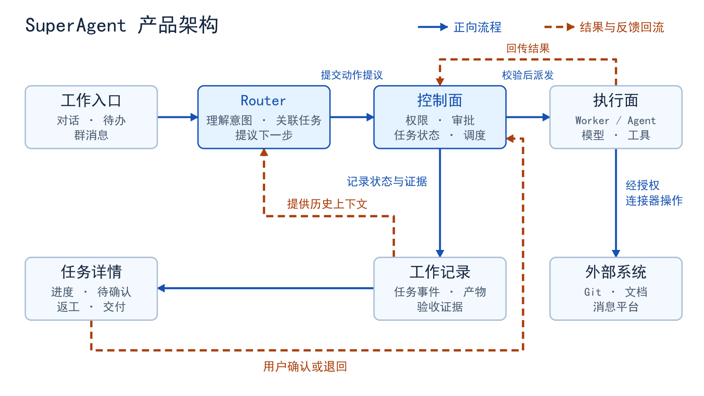
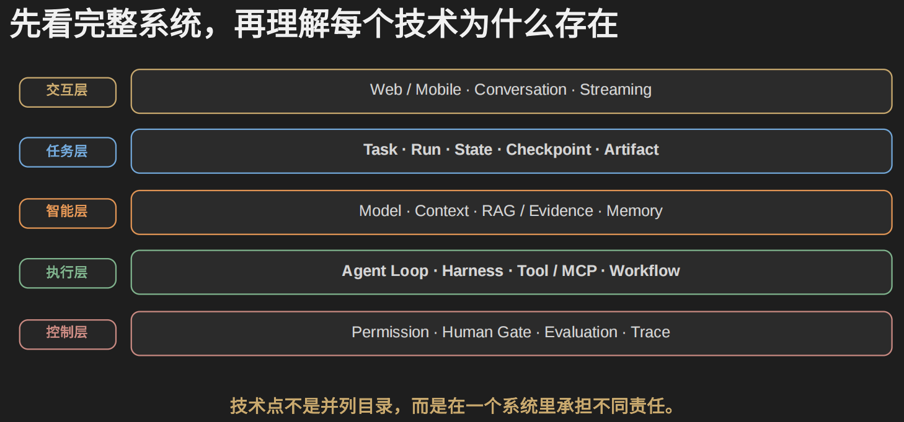

# 第一周作业

## 1、一页纸产品定义

思考 SuperAgent 这类产品究竟能服务谁？可以有哪些能力？在功能页面上是怎么呈现的？

### （1）产品定义

面向需要跨角色交付的企业团队，把一句工作需求变成可跟进、可验收、可交接的任务，并把结果和做法留在团队里。

### （2）服务谁与可以有的能力

**服务谁**：首批服务研发交付团队，后续可考虑拓展至数据、运营、内容团队。

**可以有的能力**：

- **A. 任务与协作**：人、Agent 的权限管理、任务交接、上下文交接，任务看板、会话与运行记录。
- **B. 方法与资产**：Skills、长期记忆、产出资产库。
- **C. 执行与安全**：工具调用、门禁审批、Worker 隔离。
- **D. 治理与成本**：模型路由、成本归因、审计日志、权限管理、成员管理。

### （3）功能页面呈现

**工作台（任务看板）、Agents（Skills 库、模型管理）、设置（权限、成员）……**

## 2、研发与内容生产两类任务的验收用例

内容生产可更换为其他场景。

### （1）研发任务验收

**用例 R1：需求到代码变更的闭环交付**

**验收目标**：给定一个结构化的研发任务（如“修复某表单的校验逻辑”或“为某接口补充分页参数校验”），Agent 能否从需求理解推进到可审查的代码变更，并留下可追溯的验证证据。

**操作步骤**：

1. 提交一个**边界清晰、可独立验证**的研发任务，输入包含需求描述、相关文件路径和预期行为。
2. Agent 执行后，检查是否产出：变更说明、`git diff`，以及至少一条可运行的验证命令（测试、lint 或编译）的执行结果。
3. 人工审查 diff 是否只触碰任务相关文件，是否存在越界修改。

**通过标准**：

- `git diff` 可审查，变更范围与任务声明一致，无无关文件改动。
- 验证命令（测试 / lint / build）有明确结果记录；若失败，Agent 能定位到具体文件和命令，而非仅输出“失败了”。
- 若任务涉及生成测试，新增测试在**修复前应失败、修复后应通过**，以证明测试确实覆盖了问题。

**边界说明**：此用例不验收“代码是否最优”，只验收“变更是否可审查、验证是否可复现”。代码质量的语义判断应留给 R3 的独立审查环节。

### （2）内容生产任务验收

**用例 C1：知识库边界内的内容生成**

**验收目标**：内容生产 Agent 应被知识库的检索边界约束，不能凭空编造知识库之外的事实性内容。

**操作步骤**：

1. 为目标主题配置一个覆盖度已知的知识库（例如覆盖目标主题约 80% 的素材），要求 Agent 基于该知识库撰写一份技术说明或政策摘要。
2. 在输入中故意加入一个知识库**未覆盖**但看似合理的问题点，观察 Agent 的处理方式。
3. 检查产出中事实性陈述的来源。

**通过标准**：

- 知识库覆盖范围内的事实性内容有可追溯的依据（引用、链接或知识库条目）。
- 对于知识库未覆盖的点，Agent 明确标注“信息不足”或请求补充材料，而非编造。
- 若 Agent 使用了知识库之外的信息，必须显式标注来源，且该来源可被人工复核。

## 3、产品架构图

一个 AI 应用产品的架构设计应该从哪些维度去思考？

任务从哪儿来？如何对任务做理解、分类？任务怎么拆解、控制？后续对应什么权限、状态和执行？执行该怎么做？这些执行进度、结果该怎么记录？是否需要对接外部系统，如果需要该怎么做？

**系统技术分层**：

- **交互层**：Web / Mobile · Conversation · Streaming。
- **任务层**：Task · Run · State · Checkpoint · Artifact。
- **智能层**：Model · Context · RAG / Evidence · Memory。
- **执行层**：Agent Loop · Harness · Tool / MCP · Workflow。
- **控制层**：Permission · Human Gate · Evaluation · Trace。

## 4、技术细节思考

为什么 Router 的语义协调与控制面的确定性治理需要分工？

**Router 提议下一步，控制面决定能否执行。二者分工的本质是提议权与裁决权的分离。**

Router 面对的是**语义不确定性**，处理需要结合上下文判断的问题：任务该用哪个模型、结果是否达标、失败后该重试还是换模型。它可以综合质量、成本和延迟做取舍，并根据执行结果调整方案。

控制面面对的是**规范确定性**，依据可验证的事实裁决：谁发起了动作、能访问哪些资源、预算是否充足、审批是否完成。授权由系统强制执行，模型的置信度再高，也不能替代授权或审批。

拿迁移群里一句话来说：

> 「那 3 个脚本跑完了，可以再测一下。」

- **Router 做语义协调。** 它结合群聊前文和已有任务，判断「那 3 个脚本」指的是哪个迁移问题，「再测一下」意味着安排回归验证。如果同时有两条相似任务，就提出澄清。如果能明确关联，就提交提议，例如「为迁移任务 M-42 发起回归验证」。
- **控制面做确定性治理。** 它根据当前身份、M-42 的实际状态和授权策略，判定能否发起验证、应由谁确认、允许访问哪个环境。同一消息重复送达时，按事件标识去重。它持久化决定和证据，供界面展示与事后排查。

## 5、职业发展思考

未来的 AI 工程师工作重心往哪里转？你要往哪里积累？

- **业务问题**：把模糊需求收敛成可实现、可验收的目标。
- **完整应用**：把模型、知识、工具和流程组织成可以工作的系统。
- **结果责任**：处理 Bad Case、稳定性、成本，并解释为什么成功或失败。

需求端越来越重要，端到端的问题解决能力越来越重要。技术变为基础，人际沟通、产品打造、项目管理、客户服务等方面的能力价值将越来越突出。
